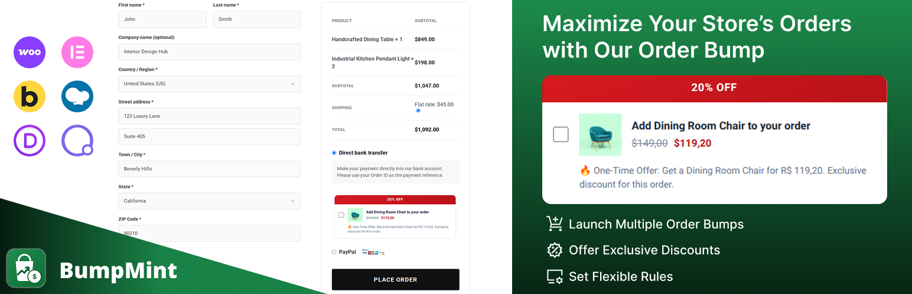
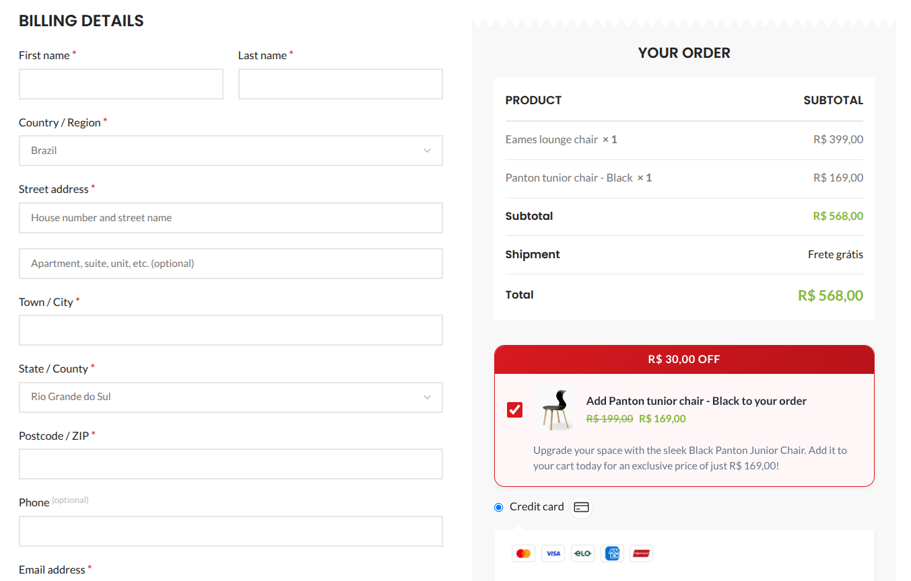
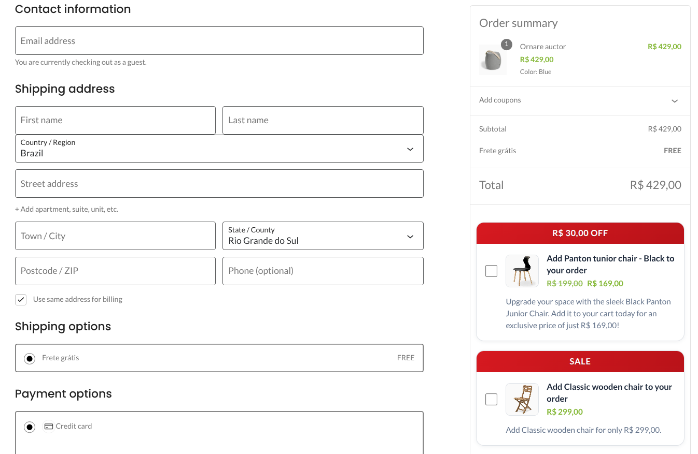
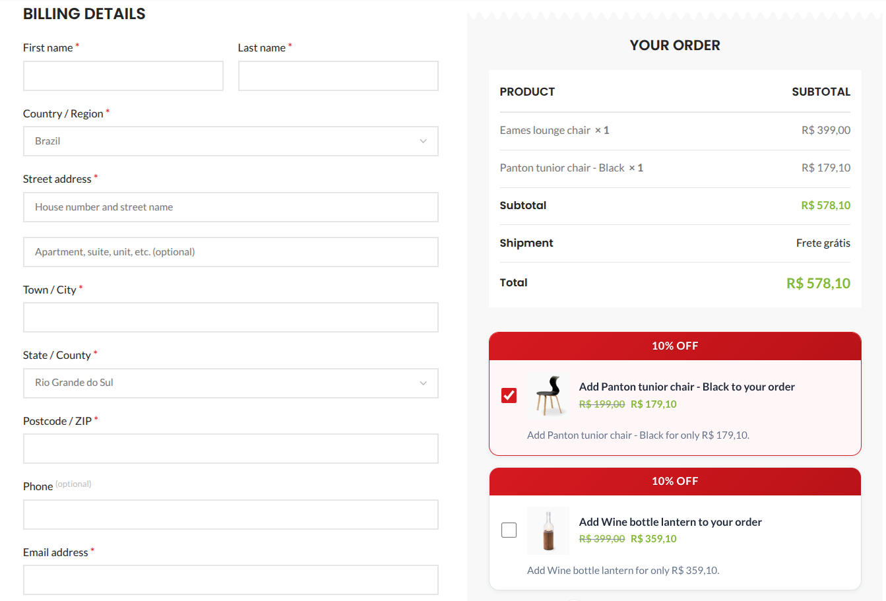
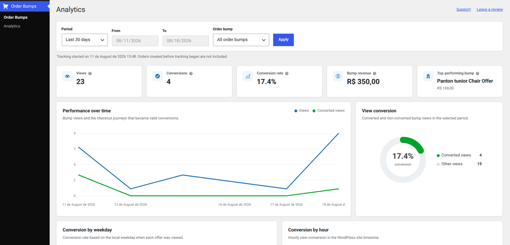
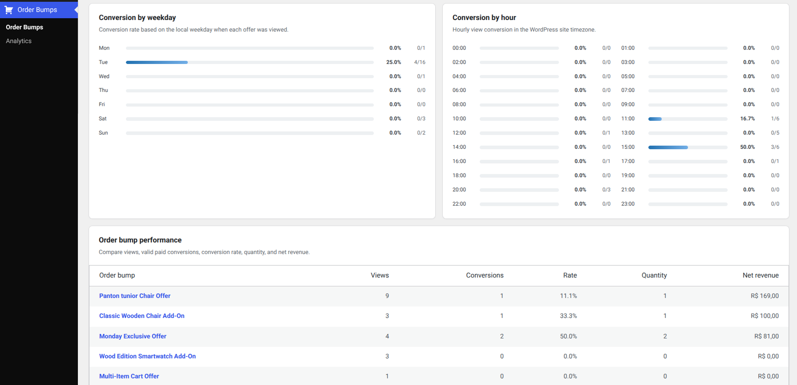

# BumpMint – Order Bump for WooCommerce



BumpMint is a lightweight WooCommerce order bump plugin that lets store owners create targeted checkout offers with flexible display rules, secure server-side discounts, multiple positions, and local performance reports. Standard products remain one-click offers, while bookable products use their native configuration form.

[WordPress.org](https://wordpress.org/plugins/bumpmint-order-bump-for-woocommerce/) · [Report an issue](https://github.com/andrewaires/bumpmint/issues)

## Turn checkout into a smarter revenue opportunity

Present relevant add-ons when customers are ready to complete their purchase. BumpMint makes it easy to create multiple order bumps, target each offer according to the cart, and customize the checkout experience without writing code.

### Highlights

- Launch multiple named order bumps.
- Offer fixed or percentage discounts.
- Limit the discounted quantity of each offered product, with a secure default of one unit.
- Trigger offers by any or all selected products, selected product categories, cart subtotal, item quantity, or show them every time.
- Schedule availability for specific dates, recurring weekdays, and optional time ranges in the WordPress site timezone.
- Include multiple separately selectable products in one order bump.
- Optionally hide an offered product when that exact product or variation is already in the cart.
- Position offers before/after order items, before payment, or before the Place order button.
- Customize the banner, product image, title, description, and dynamic placeholders.
- Support simple products, specific purchasable variations, and WooCommerce Bookings products that do not require confirmation.
- Apply discounts to effective WooCommerce prices and validate rules, products, stock, and final prices on the server.
- Keep classic and block checkout lightweight, responsive, and synchronized with WooCommerce cart updates.
- Measure checkout-journey views, paid conversions, conversion rate, net bump revenue, and the best-performing offers.
- Ready for community translations through the official WordPress.org translation platform.
- Run with WooCommerce HPOS compatibility.

## Screenshots

### Checkout experience



### Focused one-click offer



### WordPress-native management



### Flexible rules and positioning



### Custom content and secure discounts



## Display rules

BumpMint can show an offer when:

- Any or all selected products or variations are in the cart, or a product from a selected category is in the cart.
- The checkout is displayed.
- The cart subtotal is greater or less than a configured value.
- The cart item quantity is greater or less than a configured value.

Items added by BumpMint are excluded from subtotal and quantity rules so an offer cannot activate or deactivate itself.

Product and category triggers are combined with OR logic. Category-only rules are supported. Selecting a parent category also matches products in its child categories, and variations use their parent product categories.

Each rule can remain available every day, run only on selected calendar dates, or repeat on selected weekdays. An optional time range applies in the WordPress site timezone and may continue past midnight. The cart rule and availability schedule must both match before the offer appears.

## Secure discounts

For one-click offers, the browser sends only the saved rule ID, selected offer product ID, and requested selection state. Configurable booking offers submit their required fields through the native WooCommerce Bookings product form. In both flows, BumpMint verifies the saved rule and current cart on the server, resolves the effective price, validates eligibility and stock, calculates the discount, limits the discounted quantity, and enforces the trusted price during WooCommerce cart total calculations.

Each rule can hide offered products that are already present in the cart. This check applies independently to each product, while products added through that same bump remain visible so the customer can remove them.

Bookable offers use the native WooCommerce Bookings product form for date, availability, resource, and person selection. After the booking is added, the customer returns to checkout and BumpMint applies its discount to the booking cost calculated by WooCommerce. Bookings that require confirmation are excluded because they use a separate purchase flow.

## Lightweight Analytics

The **Order Bumps > Analytics** screen reports offer views by checkout journey, currently valid paid conversions, conversion rate, net product revenue, the best-performing bump, and performance by date, weekday, and hour. Reports can be filtered by period, order bump, and currency.

Conversions follow WooCommerce's current paid-order definition, normally **Processing** and **Completed**. If an order later becomes cancelled, failed, or fully refunded, its conversion is excluded. Partial refunds of a BumpMint product reduce its quantity and revenue; a fully refunded bump no longer counts as a conversion. Refunds unrelated to a bump do not remove that bump's conversion.

Bump revenue includes only product-line totals added through BumpMint, after applicable refunds and excluding taxes and shipping. Tracking starts when the Analytics version is installed, so earlier orders are intentionally not imported. Administrators can permanently reset report data without deleting rules, products, or WooCommerce orders.

Views use a random checkout-journey token kept in the WooCommerce session and stored in Analytics only as a one-way hash. The token is renewed after an order or an emptied cart, so the same bump can be counted in a later checkout without duplicate views from AJAX refreshes. BumpMint does not store customer names, email addresses, IP addresses, or user-agent strings in its Analytics tables, and no report data is sent to an external service.

## Requirements

- WordPress 6.5 or newer.
- WooCommerce 8.0 or newer.
- PHP 7.4 or newer.
- WooCommerce classic checkout or Checkout Block.

The plugin has no cart-page offer interface, so no Cart Block integration is needed.

## Installation

### From WordPress

1. Open **Plugins > Add New** in your WordPress dashboard.
2. Search for **BumpMint**.
3. Click **Install Now**, then **Activate**.
4. Open **Order Bumps** and create your first offer.

### Manual installation

1. Download the latest ZIP from [GitHub Releases](https://github.com/andrewaires/bumpmint/releases).
2. Open **Plugins > Add New > Upload Plugin**.
3. Upload the ZIP and activate BumpMint.

## Local integration tests

The integration suite runs the plugin with WordPress 7.0.2, WooCommerce 10.9.0, and PHP 8.3 through `wp-env`.

Requirements: Node.js 18.12 or newer, npm 8.19.2 or newer, and Docker.

```bash
npm ci
npm test
```

The automated suite uses an isolated environment at `http://localhost:8889`, so it cannot reset data from the development site. The test environment remains available after the run so failures can be inspected locally. Stop it when finished:

```bash
npm run test:env:stop
```

For manual browser testing, start the separate development environment at `http://localhost:8888`:

```bash
npm run env:start
npm run env:stop
```

## License

BumpMint is licensed under the [GNU General Public License v2.0 or later](LICENSE).
