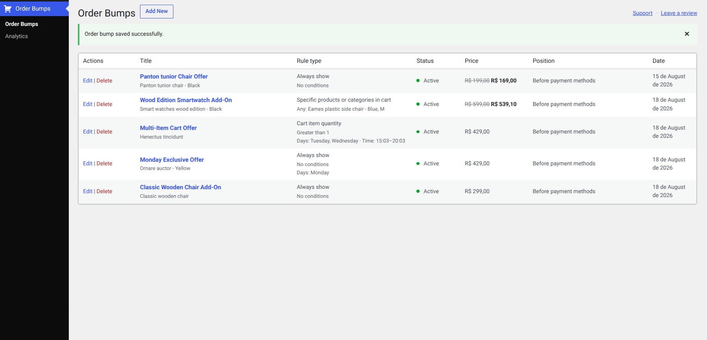
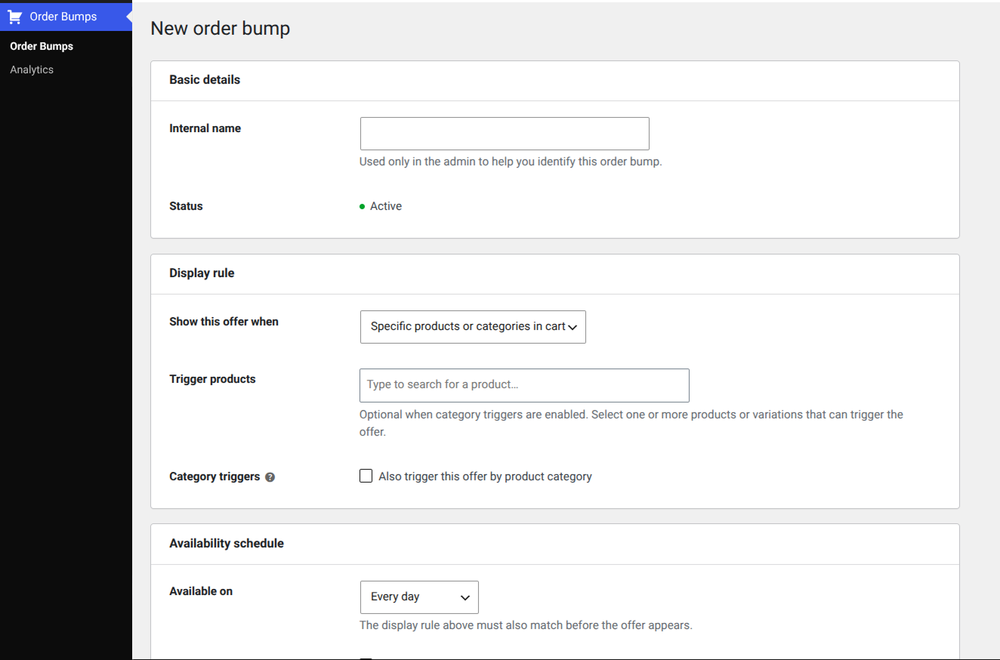
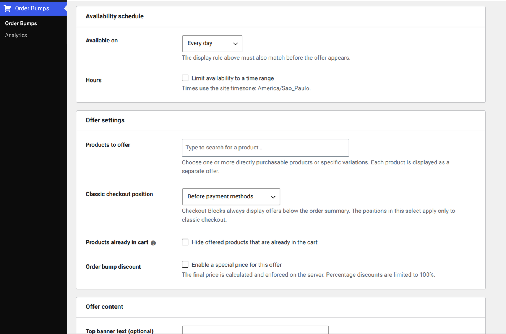
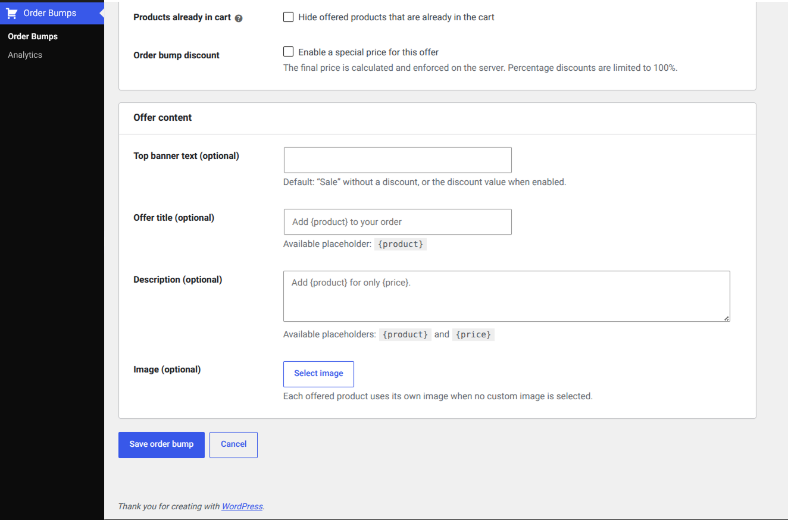

# BumpMint – Order Bump for WooCommerce


BumpMint is a lightweight WooCommerce plugin for creating order bumps and checkout upsells that help increase average order value. Display relevant offers, add custom discounts, schedule campaigns, and track paid results locally.

[WordPress.org](https://wordpress.org/plugins/bumpmint-order-bump-for-woocommerce/) · [Releases](https://github.com/andrewaires/bumpmint/releases) · [Support](https://wordpress.org/support/plugin/bumpmint-order-bump-for-woocommerce/) · [Report an issue](https://github.com/andrewaires/bumpmint/issues)

## Maximize every sale! Turn purchase intent into higher-value orders.

Display elegant, relevant offers while customers complete their purchase and let them add more products to their order with just one click. BumpMint helps stores make the most of checkout without adding another step to the buying process or sending Analytics data to external services.

### Why stores choose BumpMint

- Sell more with one click by adding relevant products directly at checkout without sending customers through another funnel.
- Set your store apart from other WooCommerce stores with a distinctive checkout experience and relevant, personalized offers.
- Use all advanced BumpMint features without a premium plan or any extra cost.
- Show the right offer by targeting products, variations, categories, cart value, item quantity, customer audiences, locations, or applied coupons.
- Run campaigns at the right time with scheduling by date, weekday, and time range.
- Stay true to your brand by customizing the banner, image, title, description, and dynamic `{product}` and `{price}` placeholders.
- Know what converts by tracking views, paid conversions, conversion rate, and net order bump revenue locally.
- Add extra safeguards by validating discounts, stock, eligibility, quantity limits, and final pricing directly on the server.

## See BumpMint in action

### Targeted offer in classic checkout


### WooCommerce Checkout Blocks


### Local performance overview


<details>
<summary>View more screenshots</summary>

### Multiple selectable offers


### Performance by weekday, hour, and campaign


### WordPress-native campaign management



### Product and category targeting



### Scheduling, products, and discounts



### Custom offer content



</details>

## Built for real WooCommerce campaigns

### Flexible targeting and timing

Product rules can match any or all selected products and variations. Category triggers use OR logic, work without a selected product, include child categories, and recognize a variation's parent categories. Subtotal, item quantity, and always-show rules are also available.

Customer targeting can include everyone, logged-in users, logged-out visitors, or selected WordPress roles. Location targeting uses WooCommerce's current shipping country and region, with billing as a fallback. Select whole countries or narrow individual countries to states or regions, and choose whether an offer remains hidden or visible while the location is unknown.

Coupon targeting can require any valid coupon currently applied to the cart or any one of the selected published WooCommerce coupons. This requirement combines with the cart, customer, location, and schedule settings, while coupon discount compatibility continues to follow WooCommerce rules.

Every campaign can run daily, on selected dates, or on recurring weekdays. An optional time range uses the WordPress site timezone and can continue past midnight.

### Offers and pricing you control

Each campaign can contain multiple products that customers select independently. Discounts use the effective WooCommerce price, support fixed or percentage values, and enforce a configurable quantity limit. BumpMint can also hide an offered product already in the cart while keeping other products from the campaign available.

Classic checkout supports four positions. Checkout Blocks display eligible offers below the order summary through WooCommerce's Store API integration.

### Visual design with a live preview

Use the **Design** tab to choose from six campaign styles: Classic, Minimal, Soft, Outline, Dark, and Compact. Customize colors, typography, spacing, borders, shadows, and image dimensions without writing CSS. Preview changes as you edit, simulate offer widths and states, and reset individual fields or the full style without clearing your offer text or image.

The preview stays visible while scrolling on wide screens. All products in a campaign share its design, while different campaigns can have different looks. Existing campaigns default to Classic, and the editor loads only in the campaign administration screen, not at checkout.

### Native WooCommerce Bookings flow

Eligible bookable products use the native product form for dates and other required options. After configuration, the customer returns to checkout and BumpMint discounts the booking price calculated by WooCommerce. Products requiring confirmation are excluded because they use a separate purchase flow.

### Privacy-friendly local Analytics

Analytics reports bump views, currently valid paid conversions, conversion rate, net product revenue, and results by date, weekday, hour, campaign, and currency. Paid statuses, cancellations, and refunds stay synchronized with WooCommerce. Revenue excludes taxes and shipping.

Report data remains in the WordPress database. BumpMint does not store names, email addresses, IP addresses, or user-agent strings in its Analytics tables and does not send report data to third parties.

## Complete Feature Overview

- **Multiple order bumps:** Manage multiple checkout campaigns from WordPress.
- **Campaign status:** Activate or deactivate an order bump without deleting its settings.
- **Customer targeting:** Show offers to everyone, logged-in users, logged-out visitors, or selected roles.
- **Location targeting:** Include or exclude countries and optional states or regions.
- **Coupon targeting:** Require any applied coupon or one of the selected WooCommerce coupons.
- **Multiple offers:** Add independently selectable products to one campaign.
- **Product and variation targeting:** Match any or all selected items.
- **Category targeting:** Match categories, child categories, or category-only rules.
- **Cart rules:** Target subtotal, item quantity, or every eligible checkout.
- **Availability scheduling:** Choose dates, weekdays, and an optional time range.
- **Flexible pricing:** Keep regular pricing or apply fixed and percentage discounts.
- **Quantity limits:** Cap discounted units for each offered product.
- **In-cart controls:** Hide an offered product already present in the cart.
- **Classic checkout positions:** Choose four offer placements.
- **Checkout Blocks:** Display offers below the block order summary.
- **WooCommerce Bookings:** Use the native form for supported bookable products.
- **Custom presentation:** Edit the banner, image, title, description, and placeholders.
- **Visual customization:** Adjust colors, fonts, sizes, spacing, borders, shadows, and images without writing CSS.
- **Live preview:** See changes as you edit and simulate offer widths and states.
- **Server-side safeguards:** Validate eligibility, products, stock, quantities, and prices.
- **Cart synchronization:** Remove only BumpMint lines that lose eligibility.
- **Local Analytics:** Track views, conversions, conversion rate, revenue, and top-performing bumps.
- **Report filters:** Compare results by date, weekday, hour, order bump, and currency.
- **WooCommerce reconciliation:** Track payments, cancellations, and refunds.
- **Private report data:** Store reports locally and reset them without deleting store records.
- **WooCommerce compatibility:** Support HPOS and compatible classic-checkout widgets.
- **Lightweight responsive assets:** Load focused CSS and JavaScript only where needed.

## Start in three steps

1. Choose the products to offer.
2. Configure targeting, schedule, checkout position, and optional discount.
3. Customize the campaign in the Design tab, preview it, save it, and track the results.

## Requirements and compatibility

- WordPress 6.5 or newer; tested through WordPress 7.1.
- WooCommerce 8.0 or newer; tested through WooCommerce 10.9.
- PHP 7.4 or newer.
- WooCommerce classic checkout or Checkout Blocks.
- WooCommerce High-Performance Order Storage (HPOS).
- Compatible checkout widgets that preserve WooCommerce hooks, including the native Elementor Pro Checkout widget.

BumpMint displays offers during checkout and intentionally has no Cart Block offer interface.

## Installation

Install **BumpMint** from **Plugins > Add New Plugin** in WordPress, upload the official ZIP from **Upload Plugin**, or upload the extracted `bumpmint-order-bump-for-woocommerce` folder to `/wp-content/plugins/` via FTP or a file manager. Activate the plugin, make sure WooCommerce is active, and open **Order Bumps** to create your first campaign. The official package is also available from [GitHub Releases](https://github.com/andrewaires/bumpmint/releases).

## Local integration tests

Requirements: Node.js 18.12 or newer, npm 8.19.2 or newer, and Docker.

```bash
npm ci
npm test
```

The automated suite uses an isolated environment at `http://localhost:8889`. Stop it when finished:

```bash
npm run test:env:stop
```

For manual browser testing, use the separate development environment at `http://localhost:8888`:

```bash
npm run env:start
npm run env:stop
```

## Changelog

See the [complete release history](changelog.txt).

## License

BumpMint is licensed under the [GNU General Public License v2.0 or later](LICENSE).
